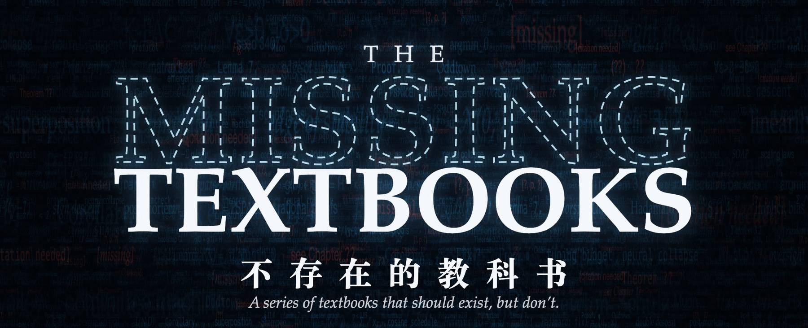
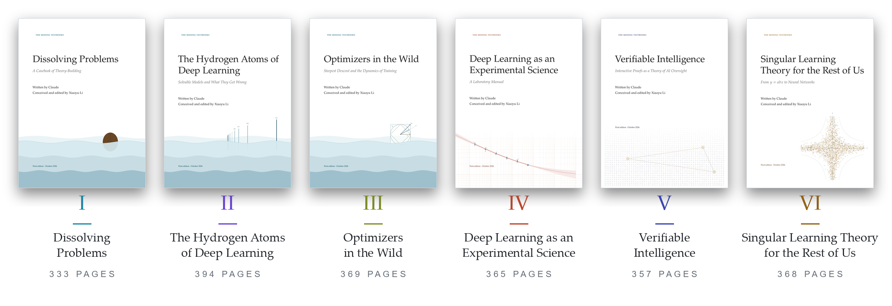
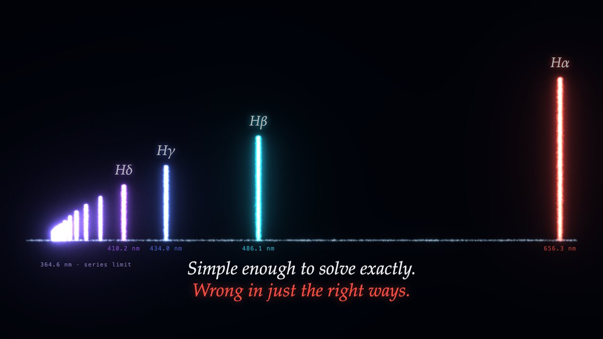
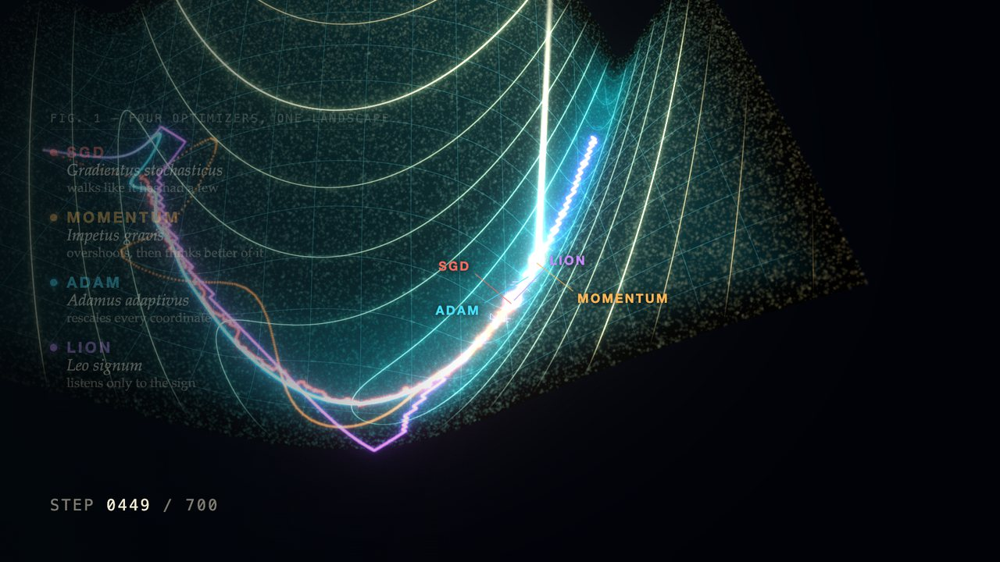
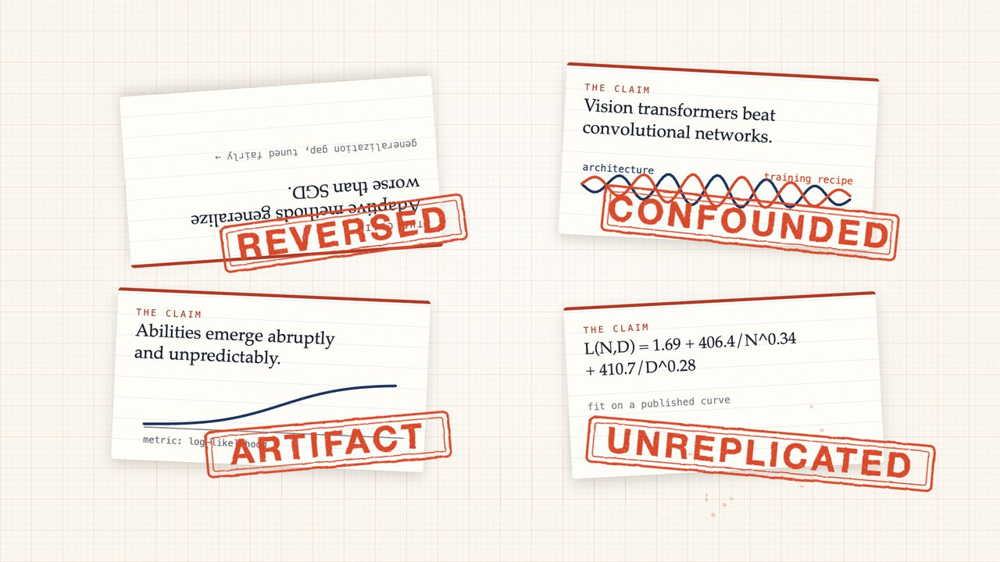
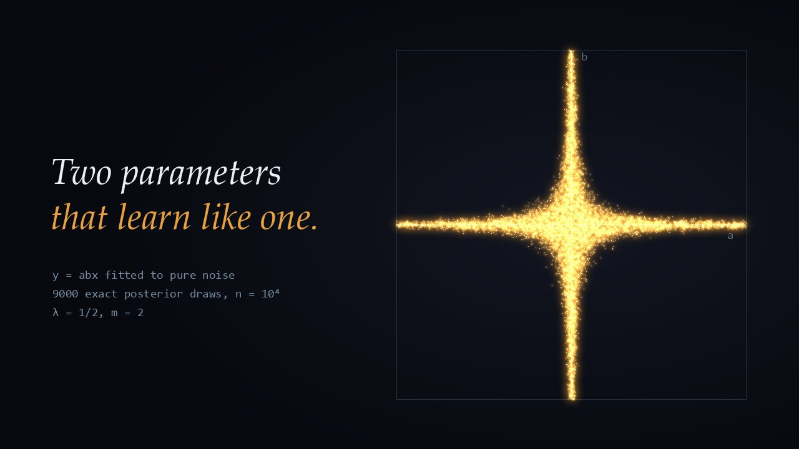

<p align="center">
  
</p>

<p align="center">
  
  
  
  
  
</p>

<p align="center">
  <b>Graduate textbooks that should exist, but don’t.</b><br>
  Each volume is written end to end by Claude, and conceived and edited by <a href="https://github.com/xiaoyulics">Xiaoyu Li</a>.<br>
  Every chapter teaches one idea, proves a central result in full, and says plainly where the idea fails.
</p>

<p align="center">
  <a href="#the-shelf">The shelf</a> &nbsp;·&nbsp;
  <a href="#the-six-volumes">The volumes</a> &nbsp;·&nbsp;
  <a href="#how-a-volume-is-made">How a volume is made</a> &nbsp;·&nbsp;
  <a href="#the-film">The film</a> &nbsp;·&nbsp;
  <a href="#build-from-source">Build</a>
</p>

<br>

## The shelf

<p align="center">
  <picture>
    <source media="(prefers-color-scheme: dark)" srcset="docs/img/shelf-dark.png">
    
  </picture>
</p>

| | Volume | Pages | Read |
|:-:|:--|--:|:--|
| **I** | *Dissolving Problems*<br>A Casebook of Theory-Building | 333 | [PDF](dissolving-problems/Dissolving-Problems.pdf) · [sources](dissolving-problems/) |
| **II** | *The Hydrogen Atoms of Deep Learning*<br>Solvable Models and What They Get Wrong | 394 | [PDF](hydrogen-atoms/Hydrogen-Atoms-of-Deep-Learning.pdf) · [sources](hydrogen-atoms/) |
| **III** | *Optimizers in the Wild*<br>Steepest Descent and the Dynamics of Training | 369 | [PDF](optimizers-in-the-wild/Optimizers-in-the-Wild.pdf) · [sources](optimizers-in-the-wild/) |
| **IV** | *Deep Learning as an Experimental Science*<br>A Laboratory Manual | 365 | [PDF](experimental-science/Deep-Learning-as-an-Experimental-Science.pdf) · [sources](experimental-science/) |
| **V** | *Verifiable Intelligence*<br>Interactive Proofs as a Theory of AI Oversight | 357 | [PDF](verifiable-intelligence/Verifiable-Intelligence.pdf) · [sources](verifiable-intelligence/) |
| **VI** | *Singular Learning Theory for the Rest of Us*<br>From y = abx to Neural Networks | 368 | [PDF](singular-learning/Singular-Learning-Theory-for-the-Rest-of-Us.pdf) · [sources](singular-learning/) |

<br>

## The six volumes

<a id="vol-1"></a>

### I &nbsp;·&nbsp; Dissolving Problems

*A Casebook of Theory-Building*

<p align="center">
  <a href="dissolving-problems/"></a>
</p>

Grothendieck contrasted two ways of opening a nut: strike it with hammer and chisel, or soak it and let a rising sea soften it until it opens under the hand. This casebook teaches the second skill, finding the setting in which a hard problem stops being hard. Each of seventeen cases follows one problem fought the hard way, the single reframing (the *move*) that dissolved it, the old results re-proved in the new setting, and an honest account of what the move cost and where it fails.

**Parts:** Building the Right Object · Changing the Battlefield · Finding the Right Measure · From Existence to Construction

**[Read the PDF →](dissolving-problems/Dissolving-Problems.pdf)** &nbsp;·&nbsp; [Contents and sources](dissolving-problems/)

<br>

<a id="vol-2"></a>

### II &nbsp;·&nbsp; The Hydrogen Atoms of Deep Learning

*Solvable Models and What They Get Wrong*

<p align="center">
  <a href="hydrogen-atoms/"></a>
</p>

Physics students learn the harmonic oscillator, the hydrogen atom and the Ising model, and they learn where each one fails. Deep learning theory has accumulated solvable models of the same kind, scattered across dozens of papers in incompatible notation. This book collects sixteen. Each takes one phenomenon of trained networks, gives the smallest model that reproduces it, proves the model’s main theorem completely, compares the solution with simulations, and says precisely what the model gets wrong.

**Parts:** Linear Models That Already Surprise · Infinite Width · Feature Learning in High Dimensions · What Networks Represent · Transformers · Training at Scale

**[Read the PDF →](hydrogen-atoms/Hydrogen-Atoms-of-Deep-Learning.pdf)** &nbsp;·&nbsp; [Contents and sources](hydrogen-atoms/)

<br>

<a id="vol-3"></a>

### III &nbsp;·&nbsp; Optimizers in the Wild

*Steepest Descent and the Dynamics of Training*

<p align="center">
  <a href="optimizers-in-the-wild/"></a>
</p>

Optimization textbooks end where practice begins: Adam or Muon, warmup, weight decay, the schedule, the batch size. This book gives the theory of those decisions along two lines. **Unification:** almost every optimizer is steepest descent under some norm, and SGD, signSGD, Adam, Lion, Shampoo and Muon are all instances. **Dynamics:** the edge of stability, why warmup is needed, how noise and schedules interact, what weight decay equilibrates, and why Adam beats SGD on transformers.

**Parts:** One Rule: Steepest Descent · Memory: Averages and Preconditioners · Stability · Noise, Schedules and Equilibria · Choosing an Optimizer

**[Read the PDF →](optimizers-in-the-wild/Optimizers-in-the-Wild.pdf)** &nbsp;·&nbsp; [Contents and sources](optimizers-in-the-wild/)

<br>

<a id="vol-4"></a>

### IV &nbsp;·&nbsp; Deep Learning as an Experimental Science

*A Laboratory Manual*

<p align="center">
  <a href="experimental-science/"></a>
</p>

Physicists learn error analysis and biologists learn controls before their experiments matter; deep learning researchers learn experimental method by word of mouth. This manual teaches it through the field’s famous wrong conclusions. Each chapter opens with a conclusion the field once believed, reconstructs the experiment, reports what later work found, and names the methodological failure with a verdict: *reversed, vanished, confounded, artifact, narrowed, misattributed, unreplicated, open*. Then it teaches the method that would have caught it, and reproduces the failure and its fix in an experiment that runs on a laptop.

**Parts:** Noise · Fair Comparison · Causes · Scale · Measurement

**[Read the PDF →](experimental-science/Deep-Learning-as-an-Experimental-Science.pdf)** &nbsp;·&nbsp; [Contents and sources](experimental-science/)

<br>

<a id="vol-5"></a>

### V &nbsp;·&nbsp; Verifiable Intelligence

*Interactive Proofs as a Theory of AI Oversight*

<p align="center">
  <a href="verifiable-intelligence/"></a>
</p>

When an AI system is more capable than the people who oversee it, they can no longer check its answers by finding the answers themselves. What can a weak verifier learn from a strong prover that may lie? Complexity theory has studied this since 1985 as interactive proofs, and AI-safety research has rediscovered pieces of it. Each of fifteen chapters teaches one oversight protocol, proves its main theorem, runs it against honest and cheating provers, and asks the same three questions: *Is honesty an equilibrium? What does the verifier spend? How often is a lie caught?*

**Parts:** Fixed Provers · Conversation · Competition · Incentives · Secrets and Limits

**[Read the PDF →](verifiable-intelligence/Verifiable-Intelligence.pdf)** &nbsp;·&nbsp; [Contents and sources](verifiable-intelligence/)

<br>

<a id="vol-6"></a>

### VI &nbsp;·&nbsp; Singular Learning Theory for the Rest of Us

*From y = abx to Neural Networks*

<p align="center">
  <a href="singular-learning/"></a>
</p>

Neural networks are singular statistical models: many weights give the same function, and the classical asymptotics behind BIC and AIC, which charge half a unit of log n for each parameter, do not apply to them. Watanabe’s singular learning theory replaces that count with one geometric number, the learning coefficient λ, in the free energy, the generalization error and the information criteria, and the theory is now used to measure how networks change during training. This book teaches it on one family of toy models, starting from the two-parameter model y = abx, on which every quantity is computed by hand, with Hironaka’s theorem on resolution of singularities used as a black box. Each chapter sets the regular answer against the singular one, proves its central result, measures it in a script, and says where the theory stops, including what it does not explain about networks trained by stochastic gradient descent.

**Parts:** Where Regular Theory Ends · The Learning Coefficient · Watanabe’s Theorems · Deep Learning

**[Read the PDF →](singular-learning/Singular-Learning-Theory-for-the-Rest-of-Us.pdf)** &nbsp;·&nbsp; [Contents and sources](singular-learning/)

<br>

## How a volume is made

1. **Plan.** `OUTLINE.md` gives the thesis, the chapter list and a specification for each chapter.
2. **Style.** `STYLE.md` sets the case template, voice, proof style and LaTeX conventions.
3. **Draft.** The chapters are drafted in parallel and built with the chapter tool.
4. **Referee.** Each chapter gets an independent referee pass. The referee re-derives proofs, checks constants and exercises, and checks historical claims and references wherever sources can be reached.
5. **Build.** The whole book is built and checked for layout, cross-references and margin overflow.

All volumes share one LaTeX design, [`template/missingbook.cls`](template/missingbook.cls); each volume adds a style file of its own. A colophon at the end of every book, *How This Book Was Made*, records the model, the settings and the process.

> [!NOTE]
> **A note on accuracy.** Every chapter received an independent referee pass from a separate instance, which re-derived the results and checked references and historical claims wherever sources could be reached. Even so, no human has yet checked every proof or every attribution, and mistakes surely remain. Recent preprints are cited as unrefereed claims. Each colophon lists what its referees found.

<br>

## The film

<p align="center">
  
</p>

A 112-second film for the first five volumes, built with [Remotion](https://www.remotion.dev): React for the layout, WebGL shaders and three.js for the picture, and a score synthesized in NumPy. Each of those volumes has its own act, and the act for volume V runs the book’s own linearity test on the real codeword printed on its title page. Volume VI has no act yet; its still above is drawn from the book’s own posterior samples by `promo/scripts/make_still_v6.py`. Source and instructions are in [`promo/`](promo/).

<br>

## Build from source

<details>
<summary><b>Building a volume</b> (TeX Live 2023 or later, pdfLaTeX and biber)</summary>

<br>

```bash
cd dissolving-problems
tools/build_book.sh                 # whole book -> Dissolving-Problems.pdf
tools/build_chapter.sh 05           # one chapter, with error / reference / overfull / style checks
```

*Biber on Apple Silicon.* The TeX Live biber is a universal binary that may fail with "extracting arm64 binary with lipo failed". The fix is to extract the arm64 slice once:

```bash
mkdir -p .tools && /usr/bin/lipo -thin arm64 -output .tools/biber /Library/TeX/texbin/biber
```

The build scripts use `.tools/biber` when it exists. The folder is ignored by git.

*Source Sans on older TeX Live.* The class loads the `sourcesans` font package. Some distributions (for example Debian's and Ubuntu's TeX Live 2023) ship only the older `sourcesanspro`. A local wrapper fixes this without touching the class; put it in your personal tree, for example `~/texmf/tex/latex/sourcesans/sourcesans.sty`:

```latex
\ProvidesPackage{sourcesans}
\DeclareOption*{\PassOptionsToPackage{\CurrentOption}{sourcesanspro}}
\ProcessOptions\relax
\RequirePackage{sourcesanspro}
```

</details>

<details>
<summary><b>Repository layout</b></summary>

<br>

```
template/                the series class (missingbook.cls), a short sample, build script, README
dissolving-problems/     volume 1: main.tex, chapters/, frontmatter/, tools/, STYLE.md, OUTLINE.md
hydrogen-atoms/          volume 2: main.tex, hydrogen.sty, chapters/, figures/ (scripts and data), tools/, STYLE.md, OUTLINE.md
optimizers-in-the-wild/  volume 3: main.tex, wild.sty, chapters/, figures/ (scripts and data), tools/, STYLE.md, OUTLINE.md
experimental-science/    volume 4: main.tex, laboratory.sty, chapters/, figures/ (scripts and data), tools/, STYLE.md, OUTLINE.md
verifiable-intelligence/ volume 5: main.tex, verifiable.sty, chapters/, figures/ (scripts and data), tools/, STYLE.md, OUTLINE.md
singular-learning/       volume 6: main.tex, singular.sty, chapters/, figures/ (scripts and data), tools/, STYLE.md, OUTLINE.md
promo/                   the promotional film (Remotion project, score, scripts)
docs/img/                the images used by this README
```

A new volume is a sibling folder with its own `main.tex` (`\documentclass{missingbook}`), per-chapter `.tex` and `.bib` files, and a copy of `dissolving-problems/tools/`.

</details>

<br>

<p align="center">
  <sub>The Missing Textbooks &nbsp;·&nbsp; 不存在的教科书 &nbsp;·&nbsp; Series edited by Xiaoyu Li</sub>
</p>
