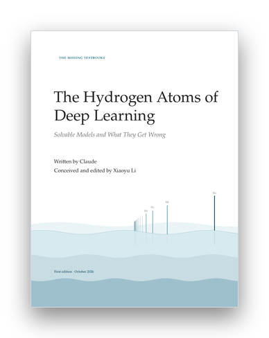

# The Hydrogen Atoms of Deep Learning: Solvable Models and What They Get Wrong

<p align="center">
  <a href="Hydrogen-Atoms-of-Deep-Learning.pdf"></a>
</p>

<p align="center"><sub><a href="../README.md">The Missing Textbooks</a> &nbsp;›&nbsp; Volume II of VI</sub></p>

*The Missing Textbooks, volume 2.* Written by Claude. Conceived and edited by Xiaoyu Li. See the colophon, "How This Book Was Made", at the end of the PDF.

Physics students learn the harmonic oscillator, the hydrogen atom and the Ising model, and they learn where each one fails. Deep learning theory has accumulated solvable models of the same kind, scattered across dozens of papers in incompatible notation. This graduate textbook collects sixteen of them. Each chapter takes one phenomenon of trained networks, gives the smallest model that reproduces it, proves the model's main theorem completely, compares the solution with simulations, and then says precisely what the model gets wrong.

**[Read the PDF](Hydrogen-Atoms-of-Deep-Learning.pdf)**.

## Contents

- **Prologue.** The hydrogen atom, and what a solvable model is for: four tests for a model, and gradient descent on a quadratic as the first hydrogen atom.
- **Part I. Linear Models That Already Surprise**
  1. Double Descent: least squares in the proportional limit
  2. Learning in Stages: exact dynamics of deep linear networks
  3. The Bias of Small Initialization: diagonal linear networks, from kernels to sparsity
  4. Training Past Zero Error: logistic regression on separable data
- **Part II. Infinite Width**
  5. Order and Chaos at Initialization: signal propagation in wide random networks
  6. Lazy Training: the neural tangent kernel and what it cannot learn
- **Part III. Feature Learning in High Dimensions**
  7. The Search Phase: single-index models and the information exponent
  8. Plateaus and Specialization: the committee machine and the ODE method
  9. Hidden Progress: sparse parities and the limits of gradient methods
- **Part IV. What Networks Represent**
  10. Grokking: modular addition and its Fourier circuit
  11. Superposition: more features than dimensions
  12. Neural Collapse: the geometry of the last layer
- **Part V. Transformers**
  13. Learning in Context: linear attention as one step of gradient descent
  14. Induction Heads: in-context Markov chains and a two-layer circuit
- **Part VI. Training at Scale**
  15. The Edge of Stability: large step sizes and the catapult
  16. Scaling Laws: power laws from spectra and from Zipf's law
- **Epilogue.** Fine structure: what the solvable models get wrong together.
- **Appendix A.** A toolkit: Gaussian calculus, random matrices, stochastic approximation, Fourier analysis.

Each chapter has the same anatomy: *The phenomenon* (with the evidence), *The model* (with a dictionary from model to network), *The solution* (a main theorem with a complete proof), *Reading the solution* (predictions against simulations), *What the model gets wrong* (what was thrown away, where it breaks, and the fine structure of corrections), a *model card*, exercises (consolidation, variation, simulation, research), and notes that translate the notation of the source papers into the book's.

## Files

- `main.tex` is the master file; `hydrogen.sty` is the volume style (model cards, dictionaries, heuristic derivations, plot styles, notation macros) loaded on top of the series class `../template/missingbook.cls`.
- `frontmatter/` holds the preface and the notation page; `backmatter/` the colophon.
- `chapters/NN-key.tex` and `chapters/NN-key.bib` hold one chapter and its bibliography.
- `figures/scripts/` holds the Python scripts (numpy, scipy, torch) that produce every numerical figure; `figures/data/` holds their output, which the chapters plot with pgfplots.
- `tools/build_book.sh` and `tools/build_chapter.sh` build and check the book and single chapters.
- `STYLE.md` is the writing guide and `OUTLINE.md` the original plan. Where the plan and a chapter differ, the chapter is correct.

## Building

```bash
cd hydrogen-atoms
tools/build_book.sh                 # whole book -> Hydrogen-Atoms-of-Deep-Learning.pdf
tools/build_chapter.sh 07           # one chapter, with error / reference / overfull / style checks
python3 figures/scripts/07-singleindex-escape.py   # regenerate one figure's data
```
