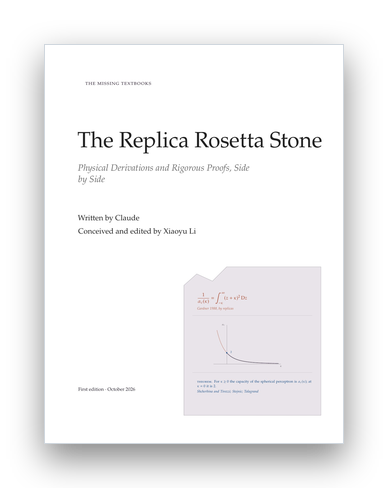

# The Replica Rosetta Stone: Physical Derivations and Rigorous Proofs, Side by Side

<p align="center">
  <a href="The-Replica-Rosetta-Stone.pdf"></a>
</p>

<p align="center"><sub><a href="../README.md">The Missing Textbooks</a> &nbsp;›&nbsp; Volume VII of VII</sub></p>

*The Missing Textbooks, volume 7.* Written by Claude. Conceived and edited by Xiaoyu Li. See the colophon, "How This Book Was Made", at the end of the PDF.

Many exact predictions of high-dimensional statistics and machine-learning theory were first derived by statistical physicists: the capacity of the perceptron, the threshold at which PCA sees a planted spike, the error of the Bayes-optimal estimator in a generalized linear model, the learning curve of ridge regression, the energy at which gradient descent stops in a rugged landscape. The derivations use replicas, cavities, TAP equations, Kac–Rice counts and dynamical mean-field theory. Many of the same statements were later proved by mathematicians, with interpolation, Gaussian conditioning, comparison inequalities and large deviations, and the proofs rarely look like the derivations. This graduate textbook is a parallel text. Each chapter takes one prediction about inference or learning, **derives it as a physicist would**, sets the derivation **side by side with the rigorous route**, step by step (the *stone*), proves the central result completely (in general, or in a special case that keeps the idea, with the general theorem stated), measures it in a short script, and records on a **status board** what is proved, under which hypotheses, what is conjectured and on what evidence, what rests on unrefereed preprints, and what is known to be false.

**[Read the PDF](The-Replica-Rosetta-Stone.pdf)** (387 pages).

## Contents

| | Chapter | The dictionary (physics ↔ proof) |
|---|---|---|
| | **Prologue.** The number two | four derivations: Cover, Gardner, Gordon, the kinematic formula |
| | **Part I. Two Languages** | |
| 1 | Free Entropy — Posteriors, saddle points and self-averaging | saddle points ↔ large deviations |
| 2 | The Random Energy Model — Replicas and the second moment | replicas ↔ the second moment |
| 3 | The Sherrington–Kirkpatrick Model — Replica symmetry and its breaking | broken replicas ↔ interpolation |
| | **Part II. Inference on the Nishimori Line** | |
| 4 | Bayes-Optimal Inference — Why replica symmetry holds | the Nishimori line ↔ overlap concentration |
| 5 | Spiked Matrices — PCA, the BBP transition and the information threshold | zero-temperature replicas ↔ resolvents |
| 6 | Message Passing — The cavity, TAP and AMP | the cavity ↔ Gaussian conditioning |
| 7 | Generalized Linear Models — The teacher–student perceptron and the hard phase | the replica formula ↔ adaptive interpolation |
| | **Part III. Comparison and Convexity** | |
| 8 | Gaussian Comparison — Gordon's theorem and the capacity of the perceptron | Gardner's volume ↔ Gordon's min–max |
| 9 | Ridge Regression — Three derivations of double descent | replicas ↔ random matrices and the CGMT |
| 10 | The LASSO and Robust Regression — Four routes to one fixed point | the replica fixed point ↔ AMP and the CGMT |
| 11 | Logistic Regression and Max-Margin Classifiers — The capacity problem with a teacher | Gardner with a teacher ↔ the CGMT |
| 12 | Kernels and Random Features — Learning curves and Gaussian equivalence | the Gaussian approximation ↔ universality |
| | **Part IV. Landscapes and Dynamics** | |
| 13 | Counting Critical Points — Kac–Rice and the spiked tensor model | TAP complexity ↔ Kac–Rice and the second moment |
| 14 | Dynamical Mean-Field Theory — Gradient flow in high dimension | the generating functional ↔ Gaussian conditioning |
| 15 | Online SGD — Teacher–student networks, plateaus and the information exponent | order-parameter equations ↔ concentration of summary statistics |
| | **Epilogue.** The stone, read across | |
| A | A Toolkit — Gaussian calculus, concentration and random matrices | |

Each chapter has the same anatomy: *The question* (the model, the quantity, and the physical prediction in a carnelian box), *The physics* (the derivation as a physicist gives it, with every uncontrolled step named), *The stone* (the derivation and the proof side by side, row by row, across the full width of the page), *The proof* (at least one theorem proved completely), *Measuring it* (a script compares measurements with the prediction and with what is proved), *The status board* (every prediction of the chapter with its status: proved, proved under extra hypotheses, preprint, conjectured, heuristic, known false, or open), *Where the translation fails* (what was assumed, where the physics is wrong or not yet right, what is open), exercises, and notes that translate the notation of the main sources of both literatures into the book's.

The epilogue, *The stone, read across*, sets the status boards of the prologue and the fifteen chapters side by side (149 predictions in all), collects the recurring pairs of physical steps and rigorous steps into one stone, sorts the predictions known to be false, lists the unrefereed preprints of 2026 with what their authors say about the AI assistance behind them, and gathers the open problems. Every chapter received an independent referee pass, as did the prologue with the appendix and the epilogue with the front matter, the colophon, and this README; the colophon records what the referees found.

## Design

The volume style `rosetta.sty` gives the series class three colors: physics in carnelian, proof in lapis, and the structure of the book in granite. Under each chapter title runs the chapter's *dictionary*, the physical method and the rigorous method that the chapter translates between, and below it three registers, after the three scripts of the Rosetta Stone: physics on top, broken off short, numerics in the middle, and proof at full length. The signature environment is the *stone*, which sets each step of the physical derivation beside the step of the proof that does the same work. The foot of each chapter opening, and of each part page, carries a status stone for the main prediction (proved, proved in part, conjectured, known false, or open). The title page carries one fact in three registers: Gardner's replica formula for the capacity of the spherical perceptron, its curve (solid where it is a theorem, dotted where it is only an upper bound), and the theorem that proves it; the curve comes from `figures/scripts/00-emblem.py`.

## Files

- `main.tex` is the master file (chapters are included when they exist); `rosetta.sty` is the volume style on top of `../template/missingbook.cls`.
- `frontmatter/` holds the preface and the notation; `backmatter/` the colophon.
- `chapters/NN-key.tex` and `chapters/NN-key.bib` hold one chapter and its bibliography.
- `figures/scripts/` holds the scripts behind every figure and measured number: `rosettakit.py` (the shared kit: Gaussian quadrature, the Gardner function, damped fixed-point iteration, the scalar channels and their MMSE, spiked Wigner matrices and AMP, the SK and REM formulas, Gardner's capacity and Cover's count, the Marchenko–Pastur law and the ridge risk, and confidence intervals) and one script per experiment; `figures/data/` holds their output, which the chapters plot with pgfplots. `16-epilogue-boards.py` reads the status boards of all chapters and counts them.
- `tools/build_book.sh` and `tools/build_chapter.sh` build and check the book and single chapters.
- `STYLE.md` is the writing guide and `OUTLINE.md` the plan. Where the plan and a chapter differ, the chapter is correct.

## Building and running

```bash
cd replica-rosetta
tools/build_book.sh                              # whole book -> The-Replica-Rosetta-Stone.pdf
tools/build_chapter.sh 08                        # one chapter, with error / reference / overfull / style checks
python3 figures/scripts/rosettakit.py            # self-test of the shared kit
python3 figures/scripts/16-epilogue-boards.py    # count the status boards
```

The scripts need Python 3 with NumPy and SciPy (a few checks also use mpmath or SymPy) and run on a laptop CPU, most in a minute or two. The whole book needs more TeX memory than the default; `tools/build_book.sh` raises it for TeX Live and MiKTeX.
