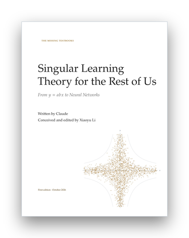

# Singular Learning Theory for the Rest of Us: From y = abx to Neural Networks

<p align="center">
  <a href="Singular-Learning-Theory-for-the-Rest-of-Us.pdf"></a>
</p>

<p align="center"><sub><a href="../README.md">The Missing Textbooks</a> &nbsp;›&nbsp; Volume VI of VI</sub></p>

*The Missing Textbooks, volume 6.* Written by Claude. Conceived and edited by Xiaoyu Li. See the colophon, "How This Book Was Made", at the end of the PDF.

Neural networks are singular statistical models: many weights give the same function, and the Fisher information is degenerate exactly where it matters. The classical asymptotics behind the Laplace approximation, BIC, and AIC, which charge a model d/2 for its d parameters, do not apply to them. Sumio Watanabe built the theory that does apply: one geometric number, the learning coefficient λ, replaces d/2 in the free energy, the generalization error, and the information criteria. The theory is now used to measure how networks change during training, but its founding monograph asks its readers to know resolution of singularities before they begin. This graduate textbook teaches it on one family of toy models, starting from the two-parameter model **y = abx**, on which every quantity is computed by hand; Hironaka's theorem is stated precisely and used as a black box. Each chapter sets **what the regular theory says** against **what the singular theory says**, proves its central result completely (in full, or for a class of models where the computation can be carried through, with the general theorem stated), and measures the result in a short script.

**[Read the PDF](Singular-Learning-Theory-for-the-Rest-of-Us.pdf)** (368 pages).

## Contents

| | Chapter | Running model |
|---|---|---|
| | **Prologue.** Two parameters | y = abx |
| | **Part I. Where Regular Theory Ends** | |
| 1 | Regular Models — What the Laplace approximation promises | y = ax₁ + bx₂ |
| 2 | Singular Models — When parameters fold | y = a tanh(bx) |
| 3 | The Free Energy by Hand — The whole theory in one coefficient | y = abx, y = ab²x |
| | **Part II. The Learning Coefficient** | |
| 4 | Volume — The learning coefficient as a scaling exponent | y = a²x₁ + b²x₂ |
| 5 | Blow-Ups — Resolution of singularities by hand | y = ax₁ + b²x₂ |
| 6 | Newton Polygons — The toric shortcut | y = a²x₁ + b³x₂ |
| 7 | A Catalogue — Learning coefficients of models in use | y = BAx |
| | **Part III. Watanabe's Theorems** | |
| 8 | The Free Energy Formula — Model selection without the Laplace approximation | y = ax₁ + b³x₂ |
| 9 | Generalization — The error λ/n and the equations of state | y = ab³x |
| 10 | WAIC — Estimating generalization without knowing λ | (1 − a)N(0,1) + aN(b,1) |
| 11 | Temperature — WBIC and the thermodynamics of the posterior | y = ax₁ + b²x₂ |
| 12 | Phase Transitions — How the posterior chooses between singularities | y = ax₁ + b²x₂, y = abx₁ + (2b⁴ − b²)x₂ |
| | **Part IV. Deep Learning** | |
| 13 | The Local Learning Coefficient — Measuring a trained network | y = a ReLU(bx), deep linear networks |
| 14 | Stages — Learning coefficients along training | the toy model of superposition |
| 15 | SGD Is Not Bayes — What the theory does not explain | y = abx under gradient descent |
| | **Epilogue.** The ledger | |
| A | A Toolkit — Integrals, singularities, and samplers | |

Each chapter has the same anatomy: *The question* (with a box saying what the regular theory answers), *By hand* (the singular answer computed on a running model in numbered steps), *The theorem* (proved completely, or proved for a class of models with the general theorem stated and its source given), *Measuring it* (a script measures the quantity and compares it with both theories: the singular prediction in bronze, the regular one in slate), *The ledger* (a card with the quantity, its regular and singular values, the running example, what was measured, and what the result rests on), *Where the theory stops* (what was assumed, where it breaks, what is open), exercises, and notes that translate the notation of the sources.

The epilogue, *The ledger*, collects the fifteen cards in two tables and sets the hypotheses of the theory against the practice of deep learning in a third. Every chapter received an independent referee pass, as did the prologue with the appendix and the epilogue with the front matter, the colophon, and this README; the colophon records what the referees found.

## Design

The volume style `singular.sty` gives the series class two voices: bronze for the singular theory and slate for the regular one, in the text, the boxes, and every plot. The rule under each chapter title is a normal crossing: a bronze rule crossed near its left end by a short slate one. The foot of each chapter opening carries the Newton polygon of a loss, in most chapters that of the running model, with the diagonal and the point (t, t) where it meets the polygon, which gives the learning coefficient λ = 1/t (Chapter 6 explains the drawing); each part page carries one too. The title page carries 2400 draws from the posterior of y = abx fitted to pure noise, which crowd onto the cross ab = 0; they come from `figures/scripts/00-emblem.py`.

## Files

- `main.tex` is the master file (chapters are included when they exist); `singular.sty` is the volume style on top of `../template/missingbook.cls`.
- `frontmatter/` holds the preface and the notation; `backmatter/` the colophon.
- `chapters/NN-key.tex` and `chapters/NN-key.bib` hold one chapter and its bibliography.
- `figures/scripts/` holds the scripts behind every figure and measured number: `sltkit.py` (the shared kit: the running models, exact posteriors by quadrature and on grids, the exact sampler for y = abx, random-walk Metropolis, thermodynamic integration, WAIC, WBIC, the two-temperature estimator, and intervals) and one script per experiment; `figures/data/` holds their output, which the chapters plot with pgfplots.
- `tools/build_book.sh` and `tools/build_chapter.sh` build and check the book and single chapters.
- `STYLE.md` is the writing guide and `OUTLINE.md` the plan. Where the plan and a chapter differ, the chapter is correct.

## Building and running

```bash
cd singular-learning
tools/build_book.sh                       # whole book -> Singular-Learning-Theory-for-the-Rest-of-Us.pdf
tools/build_chapter.sh 05                 # one chapter, with error / reference / overfull / style checks
python3 figures/scripts/sltkit.py         # self-test of the shared kit
python3 figures/scripts/00-emblem.py      # the title page's posterior draws
```

The scripts need Python 3 with NumPy and SciPy (a few checks also use mpmath or SymPy) and run on a laptop CPU, most in a minute or two. The whole book needs more TeX memory than the default; `tools/build_book.sh` raises it for TeX Live and MiKTeX.
